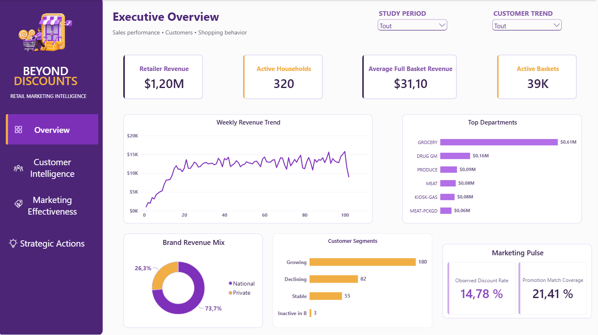
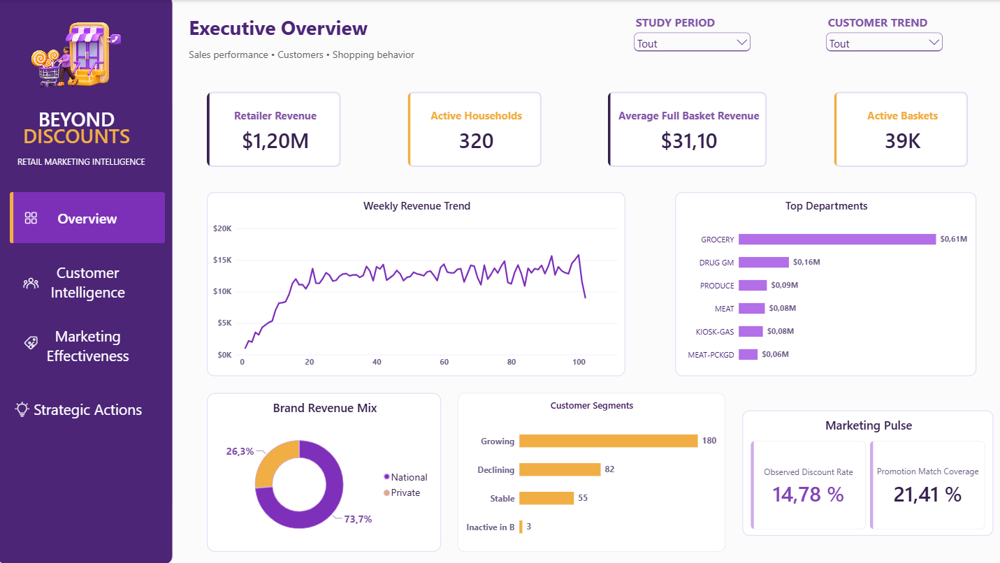
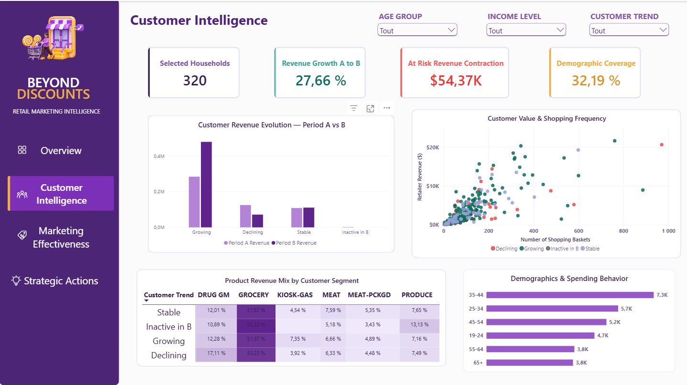
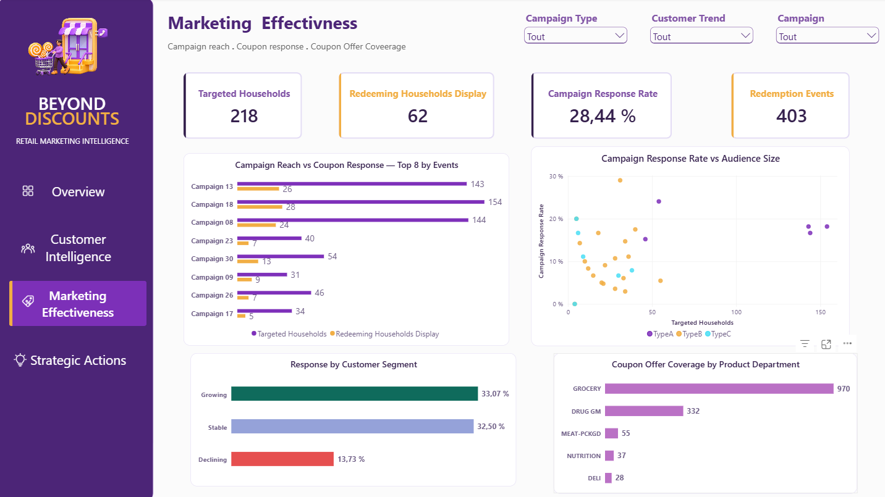
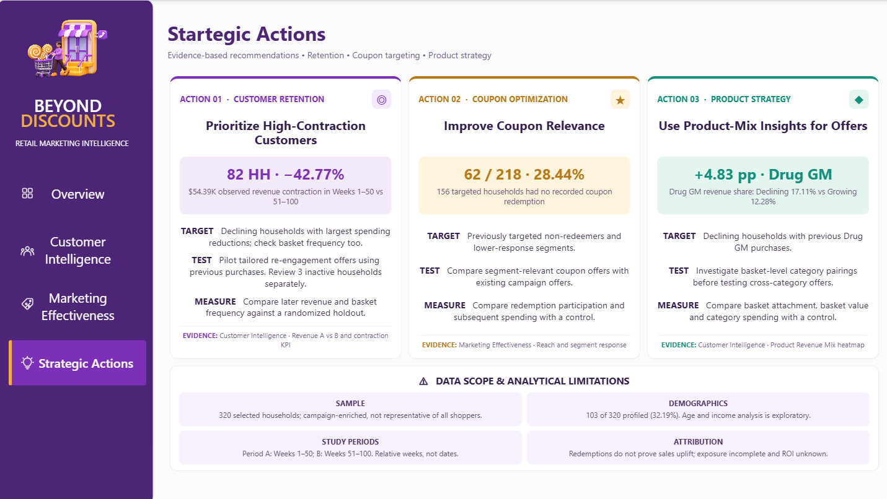

# Beyond Discounts
**Retail marketing intelligence · Power BI**

Revenue grew **27.66%** between two equal 50-week periods. Yet **82 of 320 households** spent less, and their combined revenue fell **42.77%**. This report follows that split from the sales overview to three tests a retail marketing team could run.

[Dashboard tour](#dashboard-tour) · [Decisions to test](#decisions-to-test) · [Inside the model](#inside-the-model) · [Study scope](#study-scope)

| Retailer revenue | Active households | Active baskets | Average full basket revenue |
| ---: | ---: | ---: | ---: |
| **$1.20M** | **320** | **39K** | **$31.10** |

## Dashboard tour



The tour advances every five seconds. Expand any page below to read it at your own pace, then select the page image for the full-resolution view.

<details>
<summary><strong>Executive Overview</strong> · Where does revenue come from?</summary>

Grocery contributed approximately **$610K** of the **$1.20M** in retailer revenue. Across departments, national brands accounted for **73.7%** of revenue and private labels for **26.3%**.

[](assets/executive-overview.png)

</details>

<details>
<summary><strong>Customer Intelligence</strong> · Which households drove the change?</summary>

| Growing | Stable | Declining | Inactive in Period B |
| ---: | ---: | ---: | ---: |
| 180 | 55 | 82 | 3 |

The report compares household revenue in weeks 1–50 and 51–100. The basket-frequency scatterplot helps distinguish frequent shoppers from households that generate similar revenue in fewer trips.

[](assets/customer-intelligence.png)

</details>

<details>
<summary><strong>Marketing Effectiveness</strong> · Who redeemed a coupon?</summary>

Of **218** targeted households, **62** redeemed at least one coupon (**28.44%**). Those households generated **403** recorded redemption events. Participation varied by segment, from **13.73%** among declining households to **33.07%** among growing households.

[](assets/marketing-effectiveness.png)

</details>

<details>
<summary><strong>Strategic Actions</strong> · Which interventions are worth testing?</summary>

The final page connects each finding to a target audience, a proposed test and an outcome to measure.

[](assets/strategic-actions.png)

</details>

## Decisions to test

| Evidence | Proposed test | Measure against a control group |
| --- | --- | --- |
| Revenue fell **42.77%** for the 82 declining households. | Pilot offers based on previous purchases among households with the largest spending reductions. | Subsequent revenue and basket frequency |
| **156** targeted households had no recorded redemption. | Compare segment-specific coupon offers with the existing campaign offer. | Share of households redeeming and subsequent spend |
| Drug GM accounted for **17.11%** of declining households’ revenue and **12.28%** of growing households’ revenue. | Examine which products appear together in baskets before testing a cross-category offer. | Share of baskets containing both categories, basket value and category spend |

## Inside the model

**Power Query (M)** prepares the source tables. **DAX** measures compare sales, basket value and coupon participation at three different levels of detail.

| Fact table | One row represents | Example measure |
| --- | --- | --- |
| `FactTransactions` | A transaction line | Retailer revenue |
| `FactBaskets` | A shopping basket | Average full basket revenue |
| `FactCouponRedemptions` | A recorded coupon redemption | Redemption events |

Household and study-day dimensions connect the facts. Separate bridges record campaign assignments and coupon-eligible products, so a coupon covering several products can still be counted as one offer.

<details>
<summary><strong>Inspect two DAX measures</strong></summary>

Growth compares equal-length periods. Campaign response counts distinct households, allowing a household to redeem several times while contributing once to participation.

```dax
Revenue Growth A to B =
DIVIDE (
    [Period B Revenue] - [Period A Revenue],
    [Period A Revenue]
)
```

```dax
Campaign Response Rate =
VAR Targeted = [Targeted Households]
VAR Redeemed = [Redeeming Households Display]
RETURN
    IF ( Targeted > 0, DIVIDE ( Redeemed, Targeted ), BLANK () )
```

</details>

## Study scope

- **Sample.** The study uses 320 households selected for campaign coverage. Demographic profiles exist for 103 households (32.19%), which limits conclusions about age and income.
- **Time.** The dataset spans 102 relative study weeks. The growth comparison uses weeks 1–100 to keep both periods equal.
- **Attribution.** Coupon use records participation. Estimating incremental sales or return on investment would require additional evidence, including campaign costs and a comparison group.
- **Validation.** Headline figures reflect the report pages displayed above. The project’s separate reconciliation benchmarks depend on how transaction adjustments and campaign assignments are handled.

**Farah Baraket** · Faculty of Sciences of Tunis · Power BI coursework  
**Dataset** · [dunnhumby, The Complete Journey](https://www.dunnhumby.com/source-files/)
